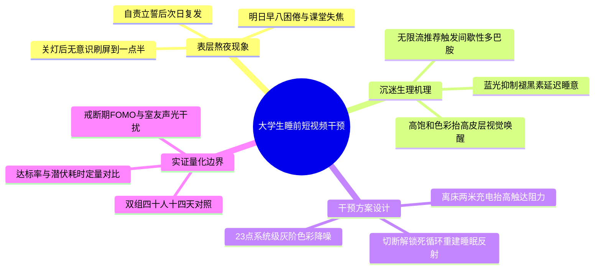

# 《“凌晨一点半综合征”：睡前短视频沉迷机制与大学生断网干预对照实验》大纲与段落契约规约

> **学生**：潘炜昊（5715126019） ｜ **课程**：人机协同程序设计 · 第 6 周实践
> **阶段归属**：【任务一：问题界定与概念收敛】+【任务二：逻辑演进与段落契约设计】的标准产物。
> **契约红线**：本文件只锁定“逻辑顺序”与“数据槽位的接口形状”，不写正文、不填数字。任何具体数值都必须等到【任务三】挂载 `raw_data.json` 后才允许注入。

---

## 一、核心题眼（Thesis Statement）

- **课题模式**：默认统一主线课题。
- **一句话题眼**：针对大学生“身体很累却停不下来”、反复拖延至凌晨一点半的睡前短视频沉迷困局，与其继续依赖“意志力自责”式的口头自律，不如引入 **“23:00 灰阶屏幕视觉降噪 + 离床两米充电物理隔离”的双重环境干预**——用视觉奖赏降级压低大脑唤醒度，用物理摩擦力抬高行为启动成本，从而把 30 分钟入睡达标率拉高约一倍、把入睡潜伏耗时压缩近七成，并同步压低次日早八困倦率。
- **可证伪的预测（三条）**：
  1. 若机理成立，干预组的 30 分钟入睡达标率应显著高于对照组；
  2. 若机理成立，两组平均入睡潜伏耗时的差距应主要来自“躺下后到真正入睡”的行为段，而非生理睡眠结构；
  3. 若机理成立，夜间入睡改善应向下游传导为次日早八困倦率的同步下降。

---

## 二、发散思维导图（Mermaid Mindmap，4×3 正交）

> **人工剪枝记录**：AI 首轮曾给出“算法伦理批判”“平台产品设计建议”两个一级维度，与本文“可实测的行为干预”题眼不同层，已剪除；保留上述 4 个一级维度，确保“现象→机理→方案→边界”构成单一因果链。

---

## 三、拓扑线性化四章制树状大纲

> 排序规则：严格遵循“现象 → 机理 → 干预与实证 → 结论与边界”的前置依赖，后文概念不得提前引用。

- **第 1 章 引言：“凌晨一点半综合征”与睡前认知失控困局**
  - **1.1 现象剖析：报复性熬夜与无限流推荐的多巴胺陷阱** — *【核心论证任务：把“熬夜”从道德问题改写为可测量的行为问题】*
  - **1.2 问题界定：从“意志力自责”走向“环境摩擦力干预”** — *【核心论证任务：提出双重干预假设并锁定两项评测指标】*
- **第 2 章 干预机制设计：视觉多巴胺剥离与物理摩擦力的双重阻断**
  - **2.1 灰阶显示模式：剥离高饱和视觉奖赏与蓝光唤醒刺激** — *【核心论证任务：说明色彩降噪如何压低皮层唤醒度】*
  - **2.2 离床物理隔离：重构行为启动摩擦力与睡眠条件反射** — *【核心论证任务：说明两米距离如何打断肌肉记忆式刷屏】*
- **第 3 章 实证评测：双组对照实验结果与行为阻断机理分析**
  - **3.1 实验设置与核心睡眠指标基准对比** — *【核心论证任务：交代双组设计并呈现三线表定量基线】*
  - **3.2 干预效能对比与行为阻断机理** — *【核心论证任务：解析达标率翻倍与潜伏期缩短的因果链】*
  - **3.3 日间精力恢复效应与早八课堂出勤质量验证** — *【核心论证任务：验证夜间改善向下游日间效能的传导】*
- **第 4 章 讨论与结论：校园睡眠干预的边界条件与推广建议**
  - **4.1 适用边界：戒断初期 FOMO 反弹与室友协同效应** — *【核心论证任务：诚实交代失效条件与应对策略】*
  - **4.2 核心结论与健康数字化作息展望** — *【核心论证任务：回收题眼并给出可复用的推广形态】*

---

## 四、第 3 章段落级写作规约（Paragraph Specification & Data Slots）

> **说明**：以下四要素卡片只声明“接口”，不写正文。槽位中已写明**单位与小数位**，这是【任务三】防幻觉的关键——单位口径在规约阶段一次性锁死，扩写阶段就不会出现“表格用分钟、正文写秒”的量纲错配。

### 3.1 实验设置与核心睡眠指标基准对比（段落契约）

| 契约要素 | 约定内容 |
| :--- | :--- |
| **【目标字数区间】** | 180～240 字，外加 1 张标准 Markdown 对比三线表 |
| **【核心论证功能】** | 交代双组对照设计与样本均衡，说明两组唯一差异是睡前干预模式，并用三线表汇总三项核心指标 |
| **【首句方向】** | 承接第 2 章的双重干预机制，说明为定量检验其促眠效果而开展 14 天受控实验 |
| **【尾句方向】** | 点出表格中两组的指标分野，自然过渡到 3.2 节的机理剖析 |
| **【禁止事项】** | 不得出现 p 值、显著性星号、置信区间（台账未提供） |

**数据槽位声明**：
- 数据集标识：`[待填槽位：基准数据集名称]`
- 对照组模式与样本量：`[待填槽位：对照组睡前模式名称]`，样本容量 `[待填槽位：对照组样本人数（单位：人）]`
- 干预组模式与样本量：`[待填槽位：干预组睡前模式名称]`，样本容量 `[待填槽位：干预组样本人数（单位：人）]`
- 汇总三线表：`[待填槽位：双组“30 分钟入睡达标人数/达标率（%）、平均入睡潜伏耗时（分钟）、次日早八困倦人数/发生率（%）”完整对比表]`

### 3.2 干预效能对比与行为阻断机理（段落契约）

| 契约要素 | 约定内容 |
| :--- | :--- |
| **【目标字数区间】** | 220～280 字 |
| **【核心论证功能】** | 定量对比两项核心指标，并补全“视觉降噪 + 物理阻力 → 打断解锁死循环”的中间因果链 |
| **【首句方向】** | 直接切入达标率与潜伏耗时的改善幅度 |
| **【尾句方向】** | 指出潜伏期缩短会映射为次日日间精力恢复，引出 3.3 节 |
| **【禁止事项】** | 禁止出现“帕累托最优”“底层逻辑”等未经定义的黑话；禁止在此节再出现原始秒数作为主叙述口径 |

**数据槽位声明**：
- 达标率对比：由对照组 `[待填槽位：对照组30分钟入睡达标率（%，保留1位小数）]` 升至干预组 `[待填槽位：干预组30分钟入睡达标率（%，保留1位小数）]`，净增 `[待填槽位：达标率提升百分点（保留1位小数）]` 个百分点。
- 潜伏耗时对比（**单位强制折算为分钟**）：由对照组 `[待填槽位：对照组平均入睡潜伏耗时（由秒折算为分钟，保留1位小数）]` 压缩至干预组 `[待填槽位：干预组平均入睡潜伏耗时（由秒折算为分钟，保留1位小数）]`，缩短率 `[待填槽位：入睡潜伏耗时缩短百分比（%，保留1位小数）]`，每晚净省 `[待填槽位：净节省分钟数（保留1位小数）]` 分钟。
- 公式槽位：`[待填槽位：入睡潜伏耗时缩短率的 LaTeX 独立公式（分子为净省分钟数，分母为对照组分钟数）]`
- 因果链槽位：`[待填槽位：灰阶剥离视觉奖赏降低皮层唤醒 + 离床充电抬高拿取阻力 → 打断无意识解锁刷屏死循环 的完整因果表述]`

### 3.3 日间精力恢复效应与早八课堂出勤质量验证（段落契约）

| 契约要素 | 约定内容 |
| :--- | :--- |
| **【目标字数区间】** | 180～230 字 |
| **【核心论证功能】** | 用早八困倦率落差验证夜间改善的日间外溢，并交代机制解释的边界（不越界做医学结论） |
| **【首句方向】** | 紧接上节，聚焦“次日早八困倦与注意力涣散” |
| **【尾句方向】** | 收束第 3 章实证结论，为第 4 章讨论边界条件作铺垫 |

**数据槽位声明**：
- 对照组早八困倦：`[待填槽位：对照组早八困倦人数（单位：人）]` 人，发生率 `[待填槽位：对照组早八困倦发生率（%，保留1位小数）]`；
- 干预组早八困倦：`[待填槽位：干预组早八困倦人数（单位：人）]` 人，发生率 `[待填槽位：干预组早八困倦发生率（%，保留1位小数）]`；
- 落差：`[待填槽位：早八困倦发生率下降百分点（保留1位小数）]` 个百分点。

---

## 五、派生指标核算口径表（供任务三比对，本阶段不填值）

| 派生指标 | 计算式 | 单位口径 |
| :--- | :--- | :--- |
| 30 分钟入睡达标率 | `pass_count / n × 100` | 百分比，1 位小数 |
| 平均入睡潜伏耗时 | `avg_sleep_sec / 60` | 分钟，1 位小数 |
| 入睡潜伏耗时缩短率 | `(对照组分钟 − 干预组分钟) / 对照组分钟 × 100` | 百分比，1 位小数 |
| 达标率提升幅度 | `干预组达标率 − 对照组达标率` | 百分点，1 位小数 |
| 早八困倦发生率 | `morning_fatigue_cases / n × 100` | 百分比，1 位小数 |
| 早八困倦下降幅度 | `对照组发生率 − 干预组发生率` | 百分点，1 位小数 |
